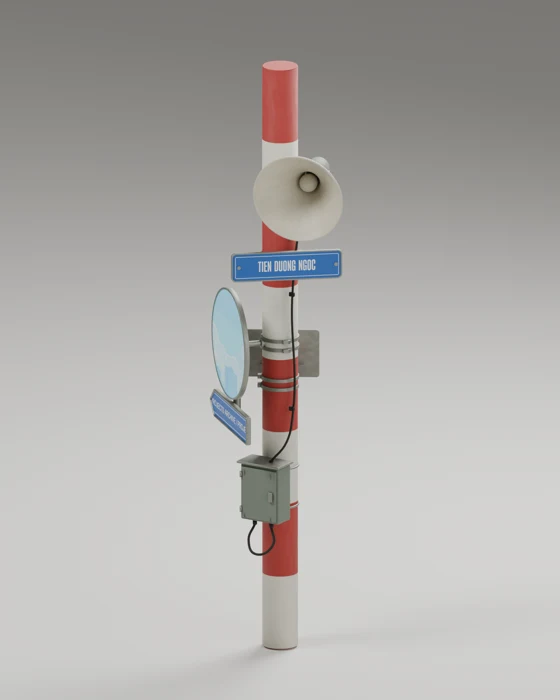

# Hanoi pole model

The homepage uses `public/models/signal-pole.glb`: a red-and-cream pole with an enamel horn loudspeaker, utility enclosure, cable fittings, and the existing navigation signs and round project display.

The web asset includes the original `Empty` camera rig, perspective camera, and `CameraAction` rotation clip. Keep these when replacing the GLB: scrolling animates the rig, and the renderer reads its embedded camera.

The 3.8 MB GLB embeds the base-color, baked roughness, and pole normal maps. Blender's refined version adds small edge bevels, reflective exposed steel, and clearcoat over enamel paint. Roughness variation is baked into textures for the browser; the studio's procedural microscopic bump is kept in the editable Blender scene. The existing HDR environment supplies web reflections. Its authored paint and UVs render directly; the client only replaces the four CMS-driven sign/display textures. The existing animated sign rendering is retained. Materials retain the names `hiroto-profile`, `to_projects`, `to_contact`, and `hirotos_showreel` for navigation and project artwork.

The original desktop/mobile field of view, camera position, exposure, and scene composition are retained. The model excludes the Blender review floor and studio lighting.

Validation: model/camera/navigation regression test, full test suite, lint, production build, and browser checks at desktop and mobile sizes. Scroll rotation, a click on the project sign, and primary navigation were checked in the browser.
